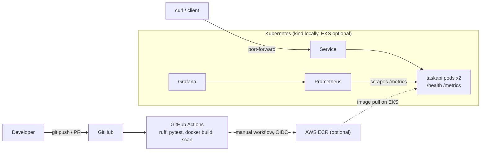

# cloud-native-devops-platform

A small Python task-management REST API used to practise the full software delivery lifecycle: automated tests, containers, CI/CD, Kubernetes, Terraform, monitoring and security basics.

The application is deliberately simple. The point of the project is everything around it.

## What this demonstrates

| Area | Where |
|---|---|
| Python API with validation, error handling, JSON logs, Prometheus metrics | `src/taskapi/app.py` |
| Automated tests and linting (pytest, Ruff) | `tests/`, `pyproject.toml` |
| Multi-stage, non-root Docker image | `Dockerfile`, `.dockerignore` |
| CI: lint, test, container build and smoke test, dependency audit, image scan | `.github/workflows/ci.yml` |
| Manual image publish to AWS ECR with short-lived OIDC credentials | `.github/workflows/publish-ecr.yml` |
| Kubernetes: Deployment, Service, ConfigMap, Secret, probes, limits, rolling updates | `k8s/base/` |
| Terraform: ECR repository, GitHub OIDC role with least-privilege policy | `terraform/` |
| Optional EKS cluster (costs money) | `terraform/eks/` |
| Prometheus and Grafana via kube-prometheus-stack | `monitoring/` |

## Architecture



Request flow: a client calls the Service, which load-balances across healthy pods. Each pod runs gunicorn serving the Flask app. Kubernetes only sends traffic to pods whose readiness probe (`/health`) passes. Prometheus scrapes `/metrics` from every pod.

More detail: [docs/architecture.md](docs/architecture.md).

## Repository layout

```
.
├── src/taskapi/app.py          # the API
├── tests/test_app.py
├── Dockerfile  .dockerignore
├── k8s/base/                   # Kubernetes manifests (kustomize)
├── monitoring/                 # Prometheus/Grafana configuration
├── terraform/                  # ECR + OIDC role; eks/ is optional and costs money
├── .github/                    # workflows, Dependabot, issue and PR templates
└── docs/                       # deployment, security, cost, troubleshooting, interview notes
```

## Prerequisites

Everything in "Run locally" is free. Install the rest only when you reach that step.

| Tool | Needed for | Windows install |
|---|---|---|
| Python 3.11+ | running and testing the API | python.org installer |
| Git | version control | `winget install Git.Git` |
| Docker Desktop | building images, running kind | docker.com |
| kind, kubectl | local Kubernetes | `winget install Kubernetes.kind Kubernetes.kubectl` |
| Helm | installing Prometheus/Grafana | `winget install Helm.Helm` |
| Terraform, AWS CLI | optional AWS phase | see docs/deployment.md |

## Run locally (PowerShell)

```powershell
python -m venv .venv
.\.venv\Scripts\Activate.ps1
pip install -r requirements-dev.txt
python src\taskapi\app.py
```

If PowerShell blocks the activate script: `Set-ExecutionPolicy -Scope CurrentUser RemoteSigned`.

In a second window:

```powershell
Invoke-RestMethod http://127.0.0.1:5000/health
Invoke-RestMethod -Method Post -Uri http://127.0.0.1:5000/tasks -ContentType "application/json" -Body '{"title":"learn docker"}'
Invoke-RestMethod http://127.0.0.1:5000/tasks
```

If `python src\taskapi\app.py` cannot find `taskapi`, run it as `$env:PYTHONPATH="src"; python -m taskapi.app` instead.

## API

| Method and path | Purpose | Success |
|---|---|---|
| `GET /health` | liveness and readiness check | 200 |
| `GET /version` | value of `APP_VERSION` | 200 |
| `GET /metrics` | Prometheus metrics | 200 |
| `GET /tasks` | list tasks | 200 |
| `POST /tasks` | create `{"title": "..."}` | 201 |
| `GET /tasks/<id>` | fetch one task | 200 / 404 |
| `PATCH /tasks/<id>` | update `title` and/or `done` | 200 / 400 / 404 |
| `DELETE /tasks/<id>` | delete | 204 / 404 |

Errors are JSON: `{"error": "message"}`. If the `API_KEY` environment variable is set, `/tasks` routes require an `X-API-Key` header.

## Test and lint

```powershell
pytest
ruff check .
ruff format --check .
```

## Docker

```powershell
docker build -t taskapi:local --build-arg APP_VERSION=local .
docker run --rm -p 5000:5000 taskapi:local
```

## Kubernetes, Terraform, monitoring

Step-by-step commands are in [docs/deployment.md](docs/deployment.md). Read [docs/cost-and-cleanup.md](docs/cost-and-cleanup.md) before creating any AWS resource.

## CI/CD in brief

On every push to `main` and every pull request, `ci.yml` runs: Ruff lint and format check, pytest on Python 3.11 and 3.12, a pip-audit dependency check (informational), then builds the Docker image, starts it, calls `/health`, and runs a Trivy scan (report only). `publish-ecr.yml` is manual-only: it authenticates to AWS with a short-lived OIDC token, so no AWS keys are stored in GitHub, and pushes an image tagged with the commit SHA.

## Security

Summary in [docs/security.md](docs/security.md): non-root container with a read-only filesystem and dropped capabilities, no credentials in the repository, least-privilege IAM role restricted to one repository and branch, immutable ECR tags, scanning in CI.

## Troubleshooting

[docs/troubleshooting.md](docs/troubleshooting.md)

## Verification status and how to produce real evidence

This README makes no claims about passing builds or running deployments. Generate your own evidence:

- Tests and lint: run `pytest` and `ruff check .` and keep the terminal output.
- CI: push to GitHub, open the Actions tab, and link the real run. Add a status badge only after a run exists (Actions, then the workflow, then "Create status badge").
- Kubernetes: save the output of `kubectl -n taskapi get pods,svc` and `kubectl -n taskapi rollout history deployment/taskapi`.
- Monitoring: take your own Grafana screenshot after sending some traffic.
- Scan results: save the Trivy step output from a CI run.
- Terraform: save `terraform plan` output with account IDs removed.

## Roadmap

- Persistent storage (PostgreSQL) so replicas share state
- Ingress controller and TLS
- Remote Terraform state with locking
- Pre-built Grafana dashboard committed as JSON
- Image signing and an SBOM
- Argo CD or Flux for GitOps deployment


