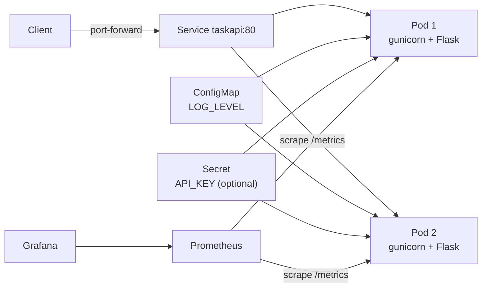
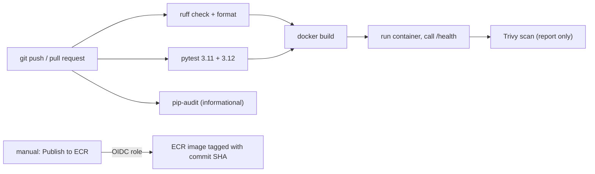

# Architecture

## Runtime

## Delivery pipeline

## Request flow

1. Client sends an HTTP request to the Service.
2. The Service forwards it to a pod that is passing its readiness probe.
3. A `before_request` hook starts a timer and, if `API_KEY` is set, checks the `X-API-Key` header.
4. The route runs, reading or changing that pod's in-memory dictionary.
5. An `after_request` hook records a request counter and a latency histogram for Prometheus.
6. JSON goes back with an HTTP status code.

## Design decisions

| Decision | Reason | Alternative |
|---|---|---|
| Flask with `create_app()` | Each test gets a fresh app and storage | Global app object |
| In-memory storage | Keeps focus on delivery | SQLite or PostgreSQL |
| One gunicorn worker, four threads | Several worker processes would each hold different data | Many workers plus a database |
| Metrics registry per app | Avoids duplicate registration errors in tests | Default global registry |
| kustomize | Built into `kubectl`, no extra tool for the basics | Helm chart |
| ClusterIP Service and port-forward | Avoids creating cloud load balancers | Ingress or LoadBalancer |
| ECR tags immutable, SHA-tagged images | Reproducible, traceable releases | `latest` tag |
| Nodes in public subnets (EKS) | Avoids NAT gateway cost | Private subnets plus NAT |
